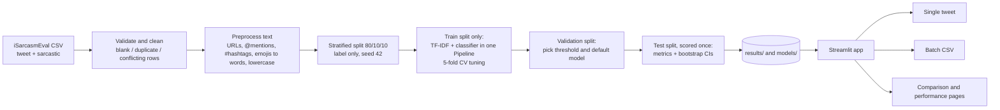

# Artha-Drishti: Machine Learning-Based Sarcasm Detection in English Tweets

Artha-Drishti ("seeing the meaning") is a Streamlit web application and a reproducible experiment pipeline that detects
**sarcasm in English tweets**. It trains and compares 11 classical machine-learning classifiers under one fixed protocol,
saves the evaluated models, and lets anyone classify a single tweet or a whole CSV file of tweets.

| | |
|---|---|
| **Owner** | Are Sanjana Reddy (24BDS0187), solo project (Team 24) |
| **Task** | Binary classification: *Sarcastic* (class 1, positive) vs *Not Sarcastic* (class 0) |
| **Data** | iSarcasmEval (SemEval-2022 Task 6) English training tweets, author-labelled |
| **Stack** | Python 3.12, scikit-learn, pandas, Streamlit, Altair |
| **Stage** | Stage 1: text-only, topic-independent comparison. The topic-aware recommender of the original proposal is a planned later stage. |

> **Read this first.** Sarcasm detection from text alone is hard and the results here are modest: the best test
> sarcastic-class F1 is about 0.37 at the default threshold (about 0.43 with a tuned threshold), with wide confidence
> intervals, and no model clearly beats a trivial "always say Sarcastic" baseline (F1 0.399). Predictions can be wrong.
> See [Results](#7-results) and [Limitations](#11-testing-limitations-and-future-scope).

---

## Table of contents
1. [Problem statement and objectives](#1-problem-statement-and-objectives)
2. [Features](#2-features)
3. [Methodology and system architecture](#3-methodology-and-system-architecture)
4. [Machine-learning models](#4-machine-learning-models)
5. [Dataset](#5-dataset)
6. [Evaluation protocol and metrics](#6-evaluation-protocol-and-metrics)
7. [Results](#7-results)
8. [Application screenshots](#8-application-screenshots)
9. [Installation and execution](#9-installation-and-execution)
10. [Project structure](#10-project-structure)
11. [Testing, limitations and future scope](#11-testing-limitations-and-future-scope)
12. [Team, acknowledgements and references](#12-team-acknowledgements-and-references)

---

## 1. Problem statement and objectives

Sarcasm says one thing and means another. A model that reads only the literal words can get the sentiment of a tweet
exactly backwards, which hurts opinion mining, moderation and social-media analysis. Tweets are short, informal and full
of slang, hashtags, mentions and emojis, and the cues that make a tweet sarcastic (tone, context, shared knowledge) are
often not in the text at all.

**Objectives**
- Build a fair, reproducible comparison of classical ML classifiers for tweet sarcasm: same data, same split, same features, same protocol.
- Evaluate with metrics that suit an imbalanced problem (about 25% sarcastic) and compare against trivial baselines instead of trusting accuracy.
- Provide a working web application backed by the saved, evaluated models, for single tweets and for CSV batches.
- Be honest about uncertainty: report confidence intervals, limitations and what has not been verified.

## 2. Features

- **Sarcasm Detector:** type or paste one tweet, choose a model and threshold, get the label, the model score, the threshold used and the text as the model saw it.
- **Batch Detector:** upload a CSV (or a `.txt` with one tweet per line) and classify every tweet with the same models, preprocessing and thresholds as the single-tweet page.
  - total, Sarcastic and Not Sarcastic counts with percentages, skipped rows, and a class-split chart
  - a table of every tweet with filter (All / Sarcastic / Not Sarcastic), text search and sort by score
  - downloadable **results CSV** (UTF-8 with BOM, opens correctly in Excel) and **summary CSV**
  - optional ad-hoc precision / recall / F1 / confusion matrix if your file has a 0/1 label column (clearly *not* the official test result)
  - optional "Compare models" to see how many tweets each of the 11 models labels Sarcastic
- **Model Comparison:** validation or test results for all models, at the default or the validation-selected threshold, with F1, precision/recall, PR-AUC, training and inference time, confusion matrices, and the trivial baselines for reference.
- **Model Performance:** per-model detail, PR curves and confusion matrices from the saved results.
- **About the Project:** problem, dataset, methodology, limitations and the reproducibility record of the saved run.
- The website only **reads saved results and saved models**. Nothing is retrained on a request and no network call is made.

Batch Detector details: [`docs/BATCH_DETECTOR.md`](docs/BATCH_DETECTOR.md).

## 3. Methodology and system architecture



1. **Data preparation** (`src/data.py`): only the `tweet` text and `sarcastic` label are used. Blank texts, exact duplicates and duplicate texts with conflicting labels are removed and counted in `results/data_report.json`. Other columns (for example `rephrase` and the sarcasm-type flags) exist only for sarcastic tweets or encode the label, so they are ignored to **prevent target leakage**.
2. **Preprocessing** (`src/preprocess.py`): HTML entities decoded, URLs become `url`, mentions become `@user`, hashtags keep their word, emojis are converted to words, text is lowercased. Punctuation and repeated letters are kept on purpose, as possible sarcasm cues.
3. **Splitting** (`src/split.py`): stratified 80/10/10 on the label, seed 42, saved as row-id lists in `results/split_indices.json`. The file is never overwritten without `--force`, and the split is checked for overlap.
4. **Features** (`src/features.py`): TF-IDF on word 1-2-grams (min_df 2, sublinear tf, at most 20,000 features). The vectoriser sits **inside** the scikit-learn Pipeline, so vocabulary and IDF are learned from training data only, including inside cross-validation. An optional word + character n-gram configuration exists (`--features word_char`).
5. **Training and tuning** (`src/train.py`, `src/models.py`): small hyper-parameter grids tuned by 5-fold stratified cross-validation on the training set, scored by sarcastic-class F1.
6. **Selection on validation data:** the decision threshold (maximising sarcastic F1) and the default model (highest validation PR-AUC; models within 0.01 are tied and the simplest wins).
7. **Final test:** the test set is scored once, with bootstrap 95% confidence intervals and paired bootstrap comparisons.
8. **Prediction** (`src/predict.py`, `src/batch.py`): the saved pipelines are loaded from `models/*.joblib`; text goes through the same preprocessing, then the saved threshold turns a score into a label.

## 4. Machine-learning models

All 11 models below are trained and evaluated under identical conditions. Comparing them tells us how much the choice of algorithm matters compared with the data, the features and the threshold.

| Model | Implementation | Family |
|---|---|---|
| SVM | `LinearSVC` | linear |
| SVM_balanced | `LinearSVC`, `class_weight="balanced"` | linear (class-weight experiment) |
| LogReg | `LogisticRegression` (also the Maximum Entropy classifier, not counted twice) | linear |
| LogReg_balanced | `LogisticRegression`, `class_weight="balanced"` | linear (class-weight experiment) |
| NaiveBayes | `MultinomialNB` | probabilistic |
| DecisionTree | `DecisionTreeClassifier` | tree |
| RandomForest | `RandomForestClassifier` | tree ensemble |
| KNN | `KNeighborsClassifier` (cosine) | instance based |
| GradientBoosting | `GradientBoostingClassifier` | tree ensemble |
| MLP | `MLPClassifier` (one hidden layer on TF-IDF) | neural |
| XGBoost | `XGBClassifier` (optional dependency) | tree ensemble |

The two `_balanced` models are a labelled class-imbalance experiment, but they are eligible to be the default model. A GloVe + BiGRU model is **planned and not yet trained** (shown as "pending"). Scores are **uncalibrated**: a "probability" from these models is a raw model output, and an SVM score is a margin, not a probability.

## 5. Dataset

- **Source:** iSarcasmEval English training file (SemEval-2022 Task 6). Tweets are labelled by their own authors, which is valuable but means one small, English-only, single-source dataset.
- **Raw size:** 3,468 rows (2,601 not sarcastic, 867 sarcastic).
- **After cleaning:** 3,450 tweets (862 sarcastic, 2,588 not sarcastic; 25.0% sarcastic). Removed: 1 blank tweet, 5 duplicate groups whose labels conflicted (all their rows), and 5 exact duplicate texts.
- **Split (stratified on label):**

| Split | Tweets | Sarcastic |
|---|---|---|
| Train | 2,760 | 690 |
| Validation | 345 | 86 |
| Test | 345 | 86 |

The dataset file is **not included** in this repository. Obtain it from the iSarcasmEval / SemEval-2022 Task 6 organisers and place it as described in [Installation](#9-installation-and-execution).

## 6. Evaluation protocol and metrics

The full rules are in [`docs/PROTOCOL.md`](docs/PROTOCOL.md). In short:

- **Positive class = Sarcastic.** Headline metrics are sarcastic-class **F1, precision and recall**, plus **PR-AUC** (average precision). Accuracy, macro F1, ROC-AUC, confusion matrices, tuning time, fit time and inference time are also stored.
- **Accuracy is misleading here.** With 75% not-sarcastic tweets, a model that always says "Not Sarcastic" scores 0.751 accuracy and F1 0.
- **Two thresholds, reported separately:** the default (0.5 for probabilities, 0 for SVM scores) and the validation-selected one (chosen on validation data only, never on test labels).
- **Uncertainty:** percentile bootstrap 95% confidence intervals (1,000 resamples of the test tweets) and paired bootstrap differences against the default model.
- **Baselines:** *always-Sarcastic* and *majority-class*, plus the sarcastic share (0.249), which is the PR-AUC of a random scorer.
- **No test-set tuning:** tuning uses training data; thresholds and the default model use validation data; the test set is scored once.

## 7. Results

Numbers below come from the saved real run of **2026-10-20** (`results/metrics.csv`, `results/run_metadata.json`) on the test set of 345 tweets (86 sarcastic). The default model, chosen on validation PR-AUC, is **LogReg_balanced**.

**Trivial baselines (same on validation and test):** always-Sarcastic: F1 **0.399**, precision 0.249, recall 1.0. Majority-class: F1 0, accuracy 0.751. Random-scorer PR-AUC: 0.249.

### Test set, default threshold

| Model | Sarcastic F1 [95% CI] | Precision | Recall | PR-AUC | Accuracy |
|---|---|---|---|---|---|
| LogReg_balanced | **0.370** [0.279, 0.460] | 0.368 | 0.372 | 0.368 | 0.684 |
| SVM_balanced | 0.347 [0.251, 0.442] | 0.358 | 0.337 | 0.372 | 0.684 |
| DecisionTree | 0.324 [0.232, 0.404] | 0.312 | 0.337 | 0.289 | 0.649 |
| SVM | 0.268 [0.177, 0.368] | 0.317 | 0.233 | 0.316 | 0.684 |
| LogReg | 0.218 [0.124, 0.315] | 0.394 | 0.151 | 0.324 | 0.730 |
| KNN | 0.193 [0.107, 0.276] | 0.237 | 0.163 | 0.248 | 0.661 |
| NaiveBayes | 0.180 [0.087, 0.278] | 0.400 | 0.116 | 0.339 | 0.736 |
| XGBoost | 0.172 [0.081, 0.264] | 0.333 | 0.116 | 0.330 | 0.722 |
| GradientBoosting | 0.111 [0.038, 0.193] | 0.273 | 0.070 | 0.285 | 0.722 |
| RandomForest | 0.099 [0.022, 0.177] | 0.333 | 0.058 | 0.297 | 0.736 |
| MLP | 0.023 [0.000, 0.073] | 0.500 | 0.012 | 0.333 | 0.751 |

### Test set, validation-selected threshold

| Model | Sarcastic F1 [95% CI] | Precision | Recall | PR-AUC |
|---|---|---|---|---|
| LogReg_balanced | **0.427** [0.344, 0.507] | 0.367 | 0.512 | 0.368 |
| SVM_balanced | **0.427** [0.361, 0.495] | 0.296 | 0.767 | 0.372 |
| XGBoost | 0.423 [0.359, 0.491] | 0.290 | 0.779 | 0.330 |
| MLP | 0.411 [0.341, 0.480] | 0.291 | 0.698 | 0.333 |
| GradientBoosting | 0.406 [0.340, 0.468] | 0.268 | 0.837 | 0.285 |
| NaiveBayes | 0.403 [0.337, 0.464] | 0.267 | 0.826 | 0.339 |
| RandomForest | 0.403 [0.341, 0.464] | 0.264 | 0.849 | 0.297 |
| KNN | 0.399 [0.341, 0.456] | 0.249 | 1.000 | 0.248 |
| DecisionTree | 0.399 [0.341, 0.456] | 0.249 | 1.000 | 0.289 |
| LogReg | 0.397 [0.335, 0.455] | 0.257 | 0.872 | 0.324 |
| SVM | 0.377 [0.313, 0.436] | 0.247 | 0.791 | 0.316 |

KNN and DecisionTree at this threshold label every tweet Sarcastic, which is exactly the always-Sarcastic baseline.

### Cost (this machine, Windows, `--n-jobs 2`)

| Model | Tuning (s) | Final fit (s) | Inference (ms/tweet) |
|---|---|---|---|
| SVM | 6.8 | 0.2 | 0.12 |
| SVM_balanced | 3.4 | 0.7 | 0.09 |
| LogReg | 11.4 | 1.1 | 0.09 |
| LogReg_balanced | 10.5 | 0.6 | 0.09 |
| NaiveBayes | 6.2 | 0.6 | 0.09 |
| DecisionTree | 35.1 | 2.6 | 0.22 |
| RandomForest | 32.2 | 7.7 | 0.74 |
| KNN | 6.8 | 0.4 | 0.27 |
| GradientBoosting | 78.2 | 12.8 | 0.13 |
| MLP | 169.4 | 17.6 | 0.11 |
| XGBoost | 219.9 | 20.0 | 0.13 |

A full training run takes about 14 minutes.

### What the results mean

- **Class weighting and threshold tuning matter more than the choice of algorithm.** The two class-weighted linear models lead at the default threshold; with a tuned threshold almost every model lands near F1 0.40 to 0.43.
- **No model's default-threshold F1 beats the always-Sarcastic baseline (0.399).** With a tuned threshold the best models reach 0.427, but every confidence interval still contains 0.399, so the difference is not conclusive.
- **All PR-AUC values are above the random level (0.249)**, so the models do rank sarcastic tweets higher than chance, but only modestly (best 0.372).
- **Confidence intervals are wide** because the test set has only 86 sarcastic tweets. Treat F1 gaps below about 0.05 as noise; the ranking of the middle models is not reliable.
- For context, strong SemEval-2022 systems are reported to reach a sarcastic F1 around 0.6 on the official test set; that figure is not verified here and is **not directly comparable** (different data and setting).

## 8. Application screenshots

Screenshots are stored in `docs/images/`. Replace these placeholders with screenshots of your own running app:

| Page | File to add |
|---|---|
| Sarcasm Detector (single tweet) | `docs/images/detector.png` |
| Batch Detector: upload and summary | `docs/images/batch_summary.png` |
| Batch Detector: results table and downloads | `docs/images/batch_table.png` |
| Model Comparison (F1, PR-AUC, timing charts) | `docs/images/comparison.png` |
| Model Performance (PR curve, confusion matrix) | `docs/images/performance.png` |

Once the files exist, embed them like this:

```markdown


```

## 9. Installation and execution

**Requirements:** Python 3.12, Windows PowerShell (the commands also work on other systems with the usual path changes), Git.

### Clone and set up

```powershell
git clone https://github.com/SanjanaReddy-2007/Artha-Drishti.git
cd Artha-Drishti
python -m venv .venv
.venv\Scripts\Activate.ps1
pip install --default-timeout=120 --retries 10 -r requirements.txt
pip install --default-timeout=120 --retries 10 -r requirements-optional.txt   # optional: xgboost
```

Pickled scikit-learn models need the **same scikit-learn version** to load; the saved run used scikit-learn 1.9.1.

### Get the data

Place the iSarcasmEval English training file at **`data\raw\train.En.csv`** (it needs a `tweet` column and a `sarcastic` column). The dataset is not redistributed here.

### Train (one stage at a time; check each output before the next)

```powershell
mkdir logs -ErrorAction SilentlyContinue
python -m src.prepare_data 2>&1 | Tee-Object logs\prepare_data.txt   # validate + clean; read results\data_report.json
python -m src.split 2>&1 | Tee-Object logs\split.txt                 # saves results\split_indices.json
python -m src.train 2>&1 | Tee-Object logs\train.txt                 # real run, all models (about 14 min)
```

Useful options for `src.train`: `--n-jobs 2`, `--features word_char`, `--bootstrap 1000`, `--models SVM,LogReg`, `--cv-folds 5`.

> **Smoke test warning.** `python -m src.train --models SVM,LogReg --limit 300 --cv-folds 3` is a quick plumbing check only. It **overwrites** `results\` and `models\` and is flagged with a red banner on the site. Never report numbers from it.

To reuse the split of an earlier project: `python -m src.split --import-existing --train-csv <train.csv> --val-csv <val.csv> --test-csv <test.csv> --text-col <col> --force`.

### Run the web application

```powershell
streamlit run demo\app.py
```

If no model has been trained, the pages show instructions instead of numbers. To try the Batch Detector without any data of your own, upload `demo/sample_tweets.csv` (made-up demo text, not dataset data).

### Batch Detector: CSV format and limits

- Any `.csv` with a column of tweet text (auto-selected if named `tweet` or `text`; otherwise you choose), or a `.txt` with one tweet per line. Wrap tweets that contain commas in double quotes.
- Encodings tried: utf-8, utf-8-sig, latin-1 (you are told if the latin-1 fallback was used).
- Limits (set in `src/config.py`): `BATCH_MAX_ROWS = 5000` rows and `BATCH_MAX_MB = 5` MB.
- Skipped rows (counted and listed, kept in the output with an empty prediction): blank tweets, tweets with no readable English words, and tweets over 1,000 characters.
- Output CSV columns: your original columns plus `predicted_label`, `predicted_class` (0/1), `score`, `threshold`, `model`, `threshold_mode`, `status`, `note`.

## 10. Project structure

```
Artha-Drishti/
├── src/
│   ├── config.py          paths, constants, batch limits, default-model rule
│   ├── preprocess.py      stateless text cleaning (+ emoji to words)
│   ├── data.py            load, validate, clean, de-duplicate
│   ├── prepare_data.py    CLI: build data/processed.csv + results/data_report.json
│   ├── split.py           stratified split saved as row-id lists; leakage checks
│   ├── features.py        TF-IDF configurations (fitted inside the Pipeline)
│   ├── models.py          model registry and hyper-parameter grids
│   ├── evaluate.py        metrics, thresholds, baselines, bootstrap CIs, timing
│   ├── train.py           tune, select threshold and default model, test once, save
│   ├── results_io.py      read saved results (no Streamlit)
│   ├── predict.py         prediction service: single tweet and predict_batch
│   └── batch.py           Batch Detector logic: parsing, checks, summary, output CSV
├── demo/
│   ├── app.py, ui.py      Streamlit entry point and shared helpers
│   ├── sample_tweets.csv  made-up demo tweets for the Batch Detector
│   └── views/             home, detector, batch, comparison, performance, about
├── tests/                 unittest suite on synthetic data (test_all.py, test_batch.py)
├── docs/                  PROTOCOL.md, BATCH_DETECTOR.md, literature-review status/template
├── data/                  raw/ (your dataset, not committed) and processed.csv (generated)
├── models/                saved pipelines *.joblib (generated; git-ignored)
├── results/               metrics, thresholds, predictions, run metadata (generated)
├── logs/                  training logs (generated)
├── requirements.txt, requirements-optional.txt, run_pipeline.ps1, MERGE_GUIDE.md
└── README.md
```

Saved artefacts written by `src.train`: `results/metrics.csv`, `results/baselines.csv`, `results/status.json`, `results/default_model.json`, `results/run_metadata.json` (versions, seed, git commit, smoke-test flag), `results/models/<name>.json`, `results/predictions/<name>_{validation,test}.csv` and `models/<name>.joblib`.

## 11. Testing, limitations and future scope

### Testing

```powershell
python -m unittest discover -s tests -t .
```

The suite has 55 tests (22 core, 33 for the Batch Detector) and uses **synthetic** data only, so it checks the plumbing (cleaning, split leakage checks, metrics, thresholds, default-model selection, prediction, CSV parsing, batch consistency with the single-tweet page), not scientific results. One test is skipped if the `emoji` package is not installed. Messages such as `NaiveBayes FAILED: boom` come from a test that deliberately breaks a model to check that failures are recorded.

### Known limitations

- Small, single-source, English-only dataset; test and validation sets have only 86 sarcastic tweets each, so confidence intervals are wide.
- Text-only: no conversation context, author, tone, images or cultural references.
- Thresholds tuned on a small validation set are noisy.
- Scores are uncalibrated.
- Weak absolute performance: no model clearly beats the always-Sarcastic baseline.
- Predictions can be wrong; do not use this system to make decisions about people.
- The saved run's `git_commit` in `run_metadata.json` is an older commit, because the code was not yet committed when the models were trained.
- No literature review or novelty check has been completed (see `docs/LITERATURE_REVIEW_STATUS.md`), so **no claim is made that any algorithm here is new**.

### Future scope

- Train a **GloVe + BiGRU** model under the same split and protocol and add it to all tables.
- Complete and document the literature search, then test one algorithm not yet applied to tweet sarcasm (candidates, unverified: Extreme Learning Machine, Tsetlin Machine, Kolmogorov-Arnold Network, Echo State Network), claiming novelty only if the search supports it.
- Stronger features: character n-grams, sentiment-contrast features, pre-trained embeddings, and possibly a transformer baseline.
- Probability calibration and robustness tests.
- Improve the zero-shot topic tagger (the "Politics & Society" group acted partly as a catch-all) and re-introduce **topic-aware classifier recommendation**: a topic-by-classifier matrix and a recommender that suggests the best classifier for a tweet.

## 12. Team, acknowledgements and references

- **Project owner:** Are Sanjana Reddy (24BDS0187), solo project.
- **Project guide:** _add your guide's name here_.
- **Acknowledgement:** thanks to the organisers of SemEval-2022 Task 6 (iSarcasmEval) for the dataset, and to my project guide for the direction to start with a topic-independent classifier comparison.

**Dataset**
- iSarcasmEval: *SemEval-2022 Task 6, Intended Sarcasm Detection in English and Arabic* (Abu Farha et al., 2022). Please verify the full citation before submitting.

**Base papers of the original proposal** (bibliographic details to be verified against the original sources before submission)
1. Telnoni et al., 2019: comparison of classifiers on tweets.
2. Pawar and Bhingarkar, 2020: machine-learning sarcasm detection on Twitter.
3. Azizan et al., 2019: lexicon-based sentiment analysis.
4. Zheng, Mobasher and Burke, 2014: transforming multi-label data to single-label for recommendation.

**Libraries:** scikit-learn, pandas, NumPy, joblib, emoji, Streamlit, Altair, and optionally XGBoost.

*Disclaimer: Artha-Drishti is an experimental academic project. Its predictions are statistical estimates, not facts.*